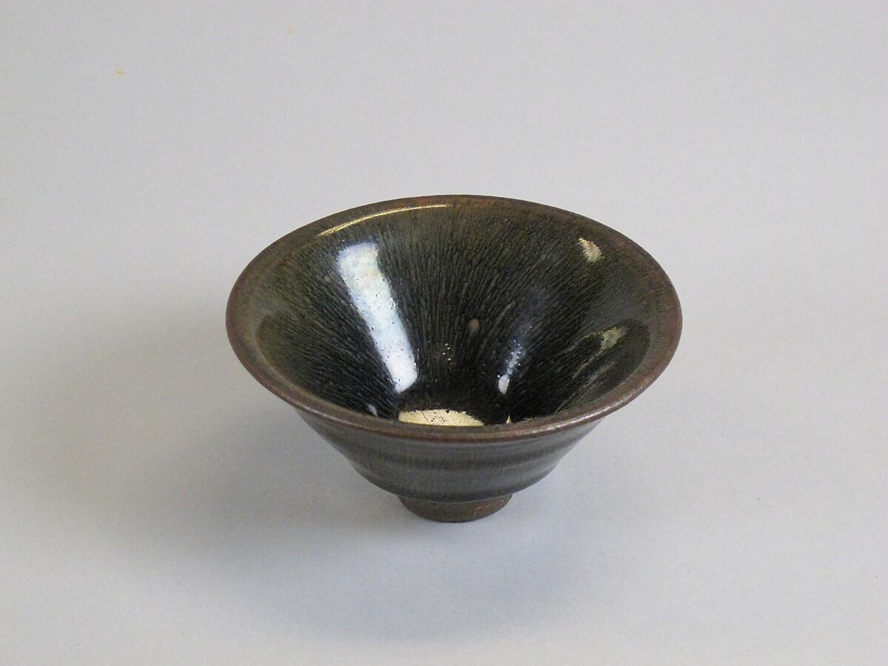

# Song-dynasty Objects — Reviewed Real-work References

> **Public distribution availability:** This is the conservative public edition: 9 bundled images, 34 withheld, with 28 of 36 directions lacking local visual comparators. Historical visual-review notes below describe earlier inspected source images, not a claim that withheld images are present or newly inspected. Check `availability` in catalog/records and the [publication policy](../publication-policy.json). Do not download missing files automatically or infer visual confirmation from text.

[Attribution criteria](../../references/02-eastern-traditions/07-song-dynasty-objects.md) · [Material index](../README.md) · [Correspondence review](../correspondence-review.md)

**Read the role before using an image.** `style_reference` is a scoped example of a named branch, not a universal or exclusive positive label. `context_only` supplies historical/site/method background and must not be used alone to establish stylistic membership.

## Distinguishing the nearby explanations

- Shared appearances: Plain monochrome ceramic bowls also occur in later Chinese and Japanese traditions.
- Inspectable distinction: Retain only as a Jian tea-bowl branch. Do not equate Song with all restrained monochrome ceramics; source notes on Japanese tenmoku reception do not make every Jian bowl a self-declared wabi-sabi work.
- Nearby explanations: 12-wabi-sabi, 05-minimalism.

## Tea bowl, Jian ware, Met object 29.100.226

- Asset ID: `07-song-dynasty-objects-01`.
- Reference role: **`style_reference`**.
- Claim scope: Specific Jian tea-bowl branch, not all Song objects; this exact view and branch only, not an exclusive or universal style label.
- Creator: Chinese Jian kiln maker not named.
- Work/version date: 11th–12th century; Song dynasty (960–1279).
- Image credit/date: unknown / not separately credited; unknown / not separately stated.
- Source: [provider page](https://www.metmuseum.org/art/collection/search/42457); [identity/context](https://www.metmuseum.org/art/collection/search/42457).
- Full local record: [07-song-dynasty-objects-01.json](../records/07-song-dynasty-objects-01.json).

### Visible relationships in this exact image

- A broad circular rim narrows continuously toward a small foot.
- The dark glazed interior carries fine irregular streaks running down toward the center.
- The visible vessel relies on its profile and glazed surface rather than attached handles or figurative relief.
- The thin-looking rim, deeper bowl wall and small supporting foot form visibly distinct levels.

### Documentary context and limit

Specific Jian tea-bowl branch, not all Song objects; this exact view and branch only, not an exclusive or universal style label.

Real object metadata supports this specific bowl. No claim that one image represents every Song kiln or proves a new object's recipe. Local white highlights are photographic reflections, not white glaze ornaments; compare the visible dark radial streaks and bowl profile.

### Selection-quality review

The full Jian bowl profile, small foot and radial dark-glaze streaks are visible against a plain background. Two bright reflections cover local glaze patches but do not prevent reading the relevant streak-to-profile relationship; reflection shape is not a glaze motif.

### Rights and attribution

Public Domain on object page; Met OA images released CC0

Tea bowl, China, 11th–12th century, Jian ware, The Met, H. O. Havemeyer Collection, 29.100.226; CC0.

[Provider-stated license / rights basis](https://www.metmuseum.org/hubs/open-access)

## Apply this evidence

Compare the organizing relationships, not just the palette, materials, names or period. These directions can overlap or contain one another; the neighboring explanation is not automatically a mutually exclusive label. Source records establish facts about this named work and cannot authenticate a new object. Two views of one project are complementary views, not independent corroboration.

When only text is available, state that the image was not inspected. Do not promote a `context_only` image to a positive example merely because a source discusses the broader aesthetic.
