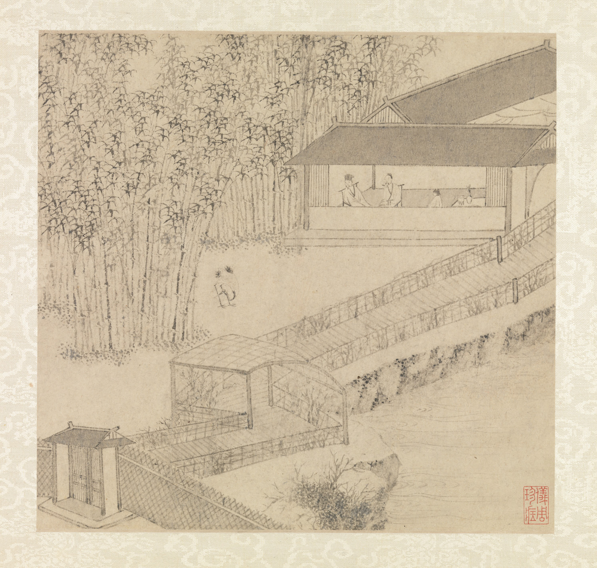

# Literati Ink — Reviewed Real-work References

> **Public distribution availability:** This is the conservative public edition: 9 bundled images, 34 withheld, with 28 of 36 directions lacking local visual comparators. Historical visual-review notes below describe earlier inspected source images, not a claim that withheld images are present or newly inspected. Check `availability` in catalog/records and the [publication policy](../publication-policy.json). Do not download missing files automatically or infer visual confirmation from text.

[Attribution criteria](../../references/02-eastern-traditions/08-literati-ink.md) · [Material index](../README.md) · [Correspondence review](../correspondence-review.md)

**Read the role before using an image.** `style_reference` is a scoped example of a named branch, not a universal or exclusive positive label. `context_only` supplies historical/site/method background and must not be used alone to establish stylistic membership.

## Distinguishing the nearby explanations

- Shared appearances: Restrained ink and blank paper occur across multiple periods and present-day design.
- Inspectable distinction: Retain. Keep album-level poetry/calligraphy context separate from the selected image, which does not show all eight leaves. State that it is Ming, not a Song work, despite restrained ink language.
- Nearby explanations: 07-song-dynasty-objects, 11-neo-chinese, 12-wabi-sabi.

## Garden of the Inept Administrator, Met object 1979.458.1a–ii

- Asset ID: `08-literati-ink-01`.
- Reference role: **`style_reference`**.
- Claim scope: Ming literati ink album; this exact view and branch only, not an exclusive or universal style label.
- Creator: Wen Zhengming.
- Work/version date: 1551.
- Image credit/date: unknown / not separately credited; unknown / not separately stated.
- Source: [provider page](https://www.metmuseum.org/art/collection/search/39654); [identity/context](https://www.metmuseum.org/art/collection/search/39654).
- Full local record: [08-literati-ink-01.json](../records/08-literati-ink-01.json).

### Visible relationships in this exact image

- A dense bamboo grove balances a more sparsely drawn pavilion and open foreground.
- Repeated bamboo stalk and leaf strokes contrast with the thin straight lines of roofs, railings and a diagonal walkway.
- Pavilion, gates and path connect several small garden spaces across the sheet.
- Large unfilled passages and light ink washes separate built and planted elements; a red seal sits apart near the lower right.

### Documentary context and limit

Ming literati ink album; this exact view and branch only, not an exclusive or universal style label.

The primary image is one garden scene, not proof that the separate Fishing Stone poem leaf is visibly present. Match exact leaf before describing poem/image correspondence; album-level metadata is not eight downloaded leaves.

### Rights and attribution

Public Domain on official record; Met OA CC0

Wen Zhengming, Garden of the Inept Administrator, 1551, The Met, Gift of Douglas Dillon, 1979, 1979.458.1a–ii; CC0.

[Provider-stated license / rights basis](https://www.metmuseum.org/hubs/open-access)

## Apply this evidence

Compare the organizing relationships, not just the palette, materials, names or period. These directions can overlap or contain one another; the neighboring explanation is not automatically a mutually exclusive label. Source records establish facts about this named work and cannot authenticate a new object. Two views of one project are complementary views, not independent corroboration.

When only text is available, state that the image was not inspected. Do not promote a `context_only` image to a positive example merely because a source discusses the broader aesthetic.
