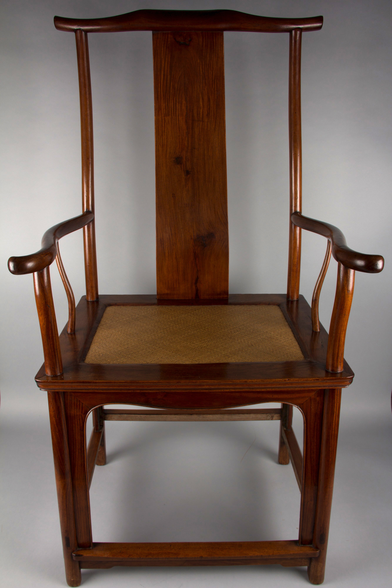

# Ming-style Furniture — Reviewed Real-work References

> **Public distribution availability:** This is the conservative public edition: 9 bundled images, 34 withheld, with 28 of 36 directions lacking local visual comparators. Historical visual-review notes below describe earlier inspected source images, not a claim that withheld images are present or newly inspected. Check `availability` in catalog/records and the [publication policy](../publication-policy.json). Do not download missing files automatically or infer visual confirmation from text.

[Attribution criteria](../../references/02-eastern-traditions/09-ming-style.md) · [Material index](../README.md) · [Correspondence review](../correspondence-review.md)

**Read the role before using an image.** `style_reference` is a scoped example of a named branch, not a universal or exclusive positive label. `context_only` supplies historical/site/method background and must not be used alone to establish stylistic membership.

## Distinguishing the nearby explanations

- Shared appearances: Bare wood, simple outlines and open frames are cross-cultural and survive beyond the Ming period.
- Inspectable distinction: Retain. Visible crest/back/arm/seat/leg relations support the type; do not infer concealed tenons from the photograph or classify every bare wooden chair as Ming-style.
- Nearby explanations: 10-imperial-court-decoration, 11-neo-chinese, 20-nordic.

## Yokeback armchair, Met object 1997.92

- Asset ID: `09-ming-style-01`.
- Reference role: **`style_reference`**.
- Claim scope: Ming-style hardwood chair; period and visible form remain separate; this exact view and branch only, not an exclusive or universal style label.
- Creator: Chinese maker not named.
- Work/version date: 17th century; late Ming–early Qing.
- Image credit/date: unknown / not separately credited; unknown / not separately stated.
- Source: [provider page](https://www.metmuseum.org/art/collection/search/39493); [identity/context](https://www.metmuseum.org/art/collection/search/39493).
- Full local record: [09-ming-style-01.json](../records/09-ming-style-01.json).

### Visible relationships in this exact image

- A wide curved crest rail spans two upright posts and a broad central back splat.
- Curved arms extend forward from the back posts, with slender intermediate supports below.
- Large open voids flank the back splat and remain between the arms, seat and legs.
- The rectangular seat frame, gently shaped apron, legs and lower stretchers make a legible hierarchy of visible components.

### Documentary context and limit

Ming-style hardwood chair; period and visible form remain separate; this exact view and branch only, not an exclusive or universal style label.

A photograph illustrates visible components/voids, not the internals of this chair or the wood species/age/joints of a new object.

### Rights and attribution

Public Domain on official record; Met OA CC0

Yokeback armchair, China, 17th century, The Met, Purchase, The Dillon Fund Gift, 1997, 1997.92; CC0.

[Provider-stated license / rights basis](https://www.metmuseum.org/hubs/open-access)

## Apply this evidence

Compare the organizing relationships, not just the palette, materials, names or period. These directions can overlap or contain one another; the neighboring explanation is not automatically a mutually exclusive label. Source records establish facts about this named work and cannot authenticate a new object. Two views of one project are complementary views, not independent corroboration.

When only text is available, state that the image was not inspected. Do not promote a `context_only` image to a positive example merely because a source discusses the broader aesthetic.

### Embedded credit

The image’s embedded Artist field reads Beatrice Pinto. The precise role is not independently confirmed; this preserves the credit without asserting a verified photographer identity.
