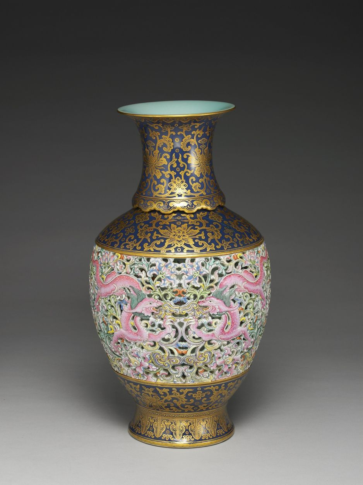
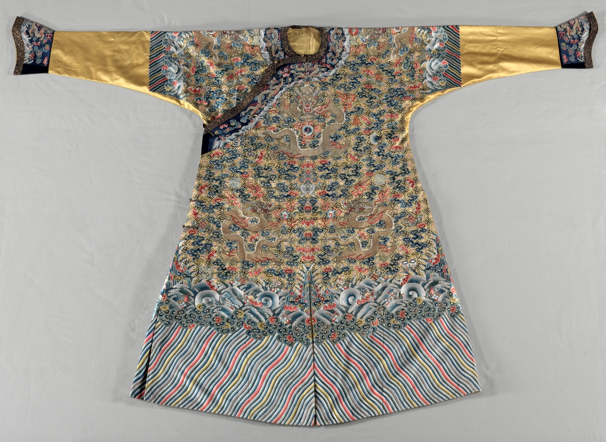

# Imperial Court Decoration — Reviewed Real-work References

> **Public distribution availability:** This is the conservative public edition: 9 bundled images, 34 withheld, with 28 of 36 directions lacking local visual comparators. Historical visual-review notes below describe earlier inspected source images, not a claim that withheld images are present or newly inspected. Check `availability` in catalog/records and the [publication policy](../publication-policy.json). Do not download missing files automatically or infer visual confirmation from text.

[Attribution criteria](../../references/02-eastern-traditions/10-imperial-court-decoration.md) · [Material index](../README.md) · [Correspondence review](../correspondence-review.md)

**Read the role before using an image.** `style_reference` is a scoped example of a named branch, not a universal or exclusive positive label. `context_only` supplies historical/site/method background and must not be used alone to establish stylistic membership.

## Distinguishing the nearby explanations

- Shared appearances: Axes, dragons, flowers, gold and dense patterns occur outside historical court work.
- Inspectable distinction: Compare documented historical context together with the visible hierarchy of bounded ornamental fields. Here ornament is abundant but zoned by the vessel’s neck, shoulder, belly and foot; it is not merely a dragon symbol applied to a generic object. Pair with the robe for another medium, without treating either as all court design.
- Nearby explanations: 09-ming-style, 11-neo-chinese, generic floral ornament, later imperial-style reproduction.

## Revolving openwork vase with dragon and lotus decoration in yangcai painted enamels, NPM 故瓷008824

- Asset ID: `10-imperial-court-decoration-03`.
- Reference role: **`style_reference`**.
- Claim scope: A documented Qianlong yangcai ceramic for comparing dense ornament organized by vessel zones, borders and hierarchy, within the museum-documented court craft context. Not proof of a particular emperor’s personal use, a universal court palette, or all Chinese ornament.
- Creator: Qing ceramic makers; individual makers not named in the collection record.
- Work/version date: Qing dynasty, Qianlong reign (1736–1795), per National Palace Museum.
- Image credit/date: National Palace Museum image; individual photographer not separately identified; not established.
- Source: [provider page](https://digitalarchive.npm.gov.tw/Collection/Detail/28657?dep=U); [identity/context](https://digitalarchive.npm.gov.tw/Collection/Detail/28657?dep=U).
- Full local record: [10-imperial-court-decoration-03.json](../records/10-imperial-court-decoration-03.json).

### Visible relationships in this exact image

- A single complete vessel is isolated against a plain gray background; no visitors, cases or labels obscure it.
- Dark blue-and-gold neck and shoulder fields contrast with a lighter, densely patterned openwork belly.
- Pink dragon-like forms and intertwined floral scrolls fill the central belly, bounded by distinct bands above and below.
- The narrower lower body and foot repeat gold scroll and leaf-like bands, organizing abundant ornament into a neck–shoulder–belly–foot hierarchy.

### Documentary context and limit

A documented Qianlong yangcai ceramic for comparing dense ornament organized by vessel zones, borders and hierarchy, within the museum-documented court craft context. Not proof of a particular emperor’s personal use, a universal court palette, or all Chinese ornament.

One frontal vessel view, not the underside, internal mechanism or all decorated media. Rotation, assembly, reign and named motifs are museum documentation, not demonstrated operation. No individual court commission, personal imperial use, precise year, hidden craftsmanship or material authenticity is independently established. Dense flowers, dragons, gold color or a reign mark alone cannot identify an unrelated object as imperial.

### Selection-quality review

The isolated whole vase has no setting clutter, readable openwork belly and sharply separated dark-blue/gold neck/shoulder/foot zones. Ornament itself creates the hierarchy; it is not extraneous scene noise.

### Rights and attribution

CC BY 4.0 for the museum open-data medium-resolution image; credit retained

Revolving openwork vase with dragon and lotus decoration in yangcai painted enamels. The National Palace Museum, Taipei, CC BY 4.0 @ www.npm.gov.tw. Accession 故瓷008824N000000000; IIIF image K1B008824N000000000PAB.

[Provider-stated license / rights basis](https://creativecommons.org/licenses/by/4.0/)

## Semi-formal Court Robe (Jifu), Cleveland Museum of Art 1983.32

- Asset ID: `10-imperial-court-decoration-04`.
- Reference role: **`style_reference`**.
- Claim scope: A documented Qing semi-formal court robe type with clear field, border, cuff and hem hierarchy. A complementary textile branch to the ceramic vase; not proof of a particular ruler’s use or a universal imperial palette.
- Creator: Chinese Qing textile makers; individual makers not named in the museum record.
- Work/version date: late 1700s; China, Qing dynasty (1644–1911), Jiaqing period (1796–1820), as catalogued.
- Image credit/date: Cleveland Museum of Art published collection image; individual photographer not separately identified; not established.
- Source: [provider page](https://www.clevelandart.org/art/1983.32); [identity/context](https://www.clevelandart.org/art/1983.32).
- Full local record: [10-imperial-court-decoration-04.json](../records/10-imperial-court-decoration-04.json).

### Visible relationships in this exact image

- The complete laid-flat garment is isolated against a neutral pale background, with both extended sleeves, cuffs and hem visible in color.
- Dense dragons and cloud-like scrolls occupy the central body and shoulders, while long gold-colored outer sleeve fields are relatively plain.
- A dark patterned border follows the collar and asymmetrical front closure, separating that edge from the main motif field.
- Dark decorated cuffs form distinct sleeve-end zones; cresting wave-like bands and a wide multicolored diagonal-striped hem create separate lower registers.

### Documentary context and limit

A documented Qing semi-formal court robe type with clear field, border, cuff and hem hierarchy. A complementary textile branch to the ceramic vase; not proof of a particular ruler’s use or a universal imperial palette.

The museum catalog dates this robe late 1700s and identifies the Jiaqing period (1796–1820); preserve that wording rather than invent an exact year. Its description associates this type with the emperor’s semi-official court meetings, but does not document this individual robe’s personal use by a named ruler. One laid-flat front view does not show the back, full three-dimensional fit or microscopic stitch construction. Motif meanings, silk/thread materials and rank/use conventions are source statements, not inferred solely from yellow, dragons or visual detail. This is a different accession from the removed Met 45.18 twelve-symbol robe; do not carry over its date, title or symbol count.

### Selection-quality review

The complete laid-flat garment is isolated against a neutral pale background, with both extended sleeves, cuffs and hem visible in color. Dense dragons and cloud-like scrolls occupy the central body and shoulders, while long gold-colored outer sleeve fields are relatively plain. A dark patterned border follows the collar and asymmetrical front closure, separating that edge from the main motif field. Dark decorated cuffs form distinct sleeve-end zones; cresting wave-like bands and a wide multicolored diagonal-striped hem create separate lower registers.

### Rights and attribution

Cleveland Museum of Art Open Access, CC0 image of a public-domain artwork

Semi-formal Court Robe (Jifu), China, Qing dynasty, Jiaqing period, late 1700s. Silk: satin weave; silk and metal thread: embroidery. The Cleveland Museum of Art, Purchase from the J. H. Wade Fund, 1983.32. CC0.

[Provider-stated license / rights basis](https://creativecommons.org/publicdomain/zero/1.0/)

## Apply this evidence

Compare the organizing relationships, not just the palette, materials, names or period. These directions can overlap or contain one another; the neighboring explanation is not automatically a mutually exclusive label. Source records establish facts about this named work and cannot authenticate a new object. Two views of one project are complementary views, not independent corroboration.

When only text is available, state that the image was not inspected. Do not promote a `context_only` image to a positive example merely because a source discusses the broader aesthetic.
