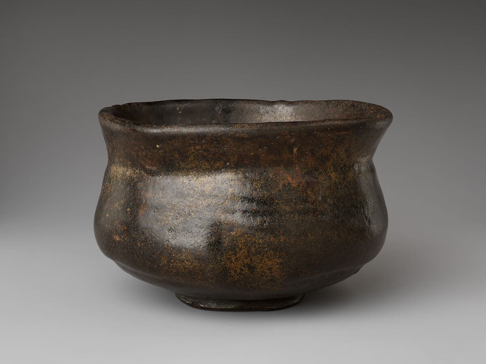

# Wabi-sabi — Reviewed Real-work References

> **Public distribution availability:** This is the conservative public edition: 9 bundled images, 34 withheld, with 28 of 36 directions lacking local visual comparators. Historical visual-review notes below describe earlier inspected source images, not a claim that withheld images are present or newly inspected. Check `availability` in catalog/records and the [publication policy](../publication-policy.json). Do not download missing files automatically or infer visual confirmation from text.

[Attribution criteria](../../references/02-eastern-traditions/12-wabi-sabi.md) · [Material index](../README.md) · [Correspondence review](../correspondence-review.md)

**Read the role before using an image.** `style_reference` is a scoped example of a named branch, not a universal or exclusive positive label. `context_only` supplies historical/site/method background and must not be used alone to establish stylistic membership.

## Distinguishing the nearby explanations

- Shared appearances: Dark pottery, aging, irregularity and restraint also occur in Song wares, Minimalism and ordinary damage.
- Inspectable distinction: The bowl’s restrained but nonuniform profile and surface can be inspected together; hand-forming, tea use and wabi practice are separately documented. A Japanese place, neutral palette or geometrically raked garden alone would not establish those individual and time-related relationships.
- Nearby explanations: 05-minimalism, 21-japandi, 23-mediterranean.

## Black Raku Tea Bowl, Kaedegure, Met 2024.553.19

- Asset ID: `12-wabi-sabi-02`.
- Reference role: **`style_reference`**.
- Claim scope: A scoped Wabi-sabi-like tea-object comparison using visible individuality plus separately documented wabi-cha and tea-use context; not a proof of a maker’s philosophy.
- Creator: In the style of Raku Chōjirō; individual maker not established.
- Work/version date: 17th century, Edo period.
- Image credit/date: unknown / not separately credited on the inspected provider page; unknown / not separately dated.
- Source: [provider page](https://www.metmuseum.org/art/collection/search/827671); [identity/context](https://www.metmuseum.org/art/collection/search/827671).
- Full local record: [12-wabi-sabi-02.json](../records/12-wabi-sabi-02.json).

### Visible relationships in this exact image

- A slightly varying rim tops a largely round body that narrows and expands before reaching the small foot.
- A dark undecorated surface shows tonal layers and local sheen rather than a perfectly uniform color field.
- Restrained vessel form leaves these small profile and surface differences visible without a separate figurative decoration.

### Documentary context and limit

A scoped Wabi-sabi-like tea-object comparison using visible individuality plus separately documented wabi-cha and tea-use context; not a proof of a maker’s philosophy.

The museum says hand-formed, a regular circular foot, exterior luster and interior wear from extended tea use. The photograph does not independently distinguish use wear from firing/glaze variation; do not call it obviously broken, wholly matte, strongly asymmetric or made by Chōjirō himself. Raku ware is not automatically Wabi-sabi in every use. The connection is a documented tea-practice comparator, not a universal style certification.

### Selection-quality review

The full isolated bowl has a gently irregular rim/body profile, uneven dark surface and local sheen, with no competitive props. Its restrained format makes small material differences inspectable.

### Rights and attribution

Public Domain; Met Open Access CC0 image

Black Raku Tea Bowl, named Kaedegure (Twilight by the Maples), in the style of Raku Chōjirō, 17th century. The Metropolitan Museum of Art, Gift of Peggy and Richard M. Danziger, 2024, 2024.553.19. Public Domain.

[Provider-stated license / rights basis](https://www.metmuseum.org/hubs/open-access)

## Apply this evidence

Compare the organizing relationships, not just the palette, materials, names or period. These directions can overlap or contain one another; the neighboring explanation is not automatically a mutually exclusive label. Source records establish facts about this named work and cannot authenticate a new object. Two views of one project are complementary views, not independent corroboration.

When only text is available, state that the image was not inspected. Do not promote a `context_only` image to a positive example merely because a source discusses the broader aesthetic.
