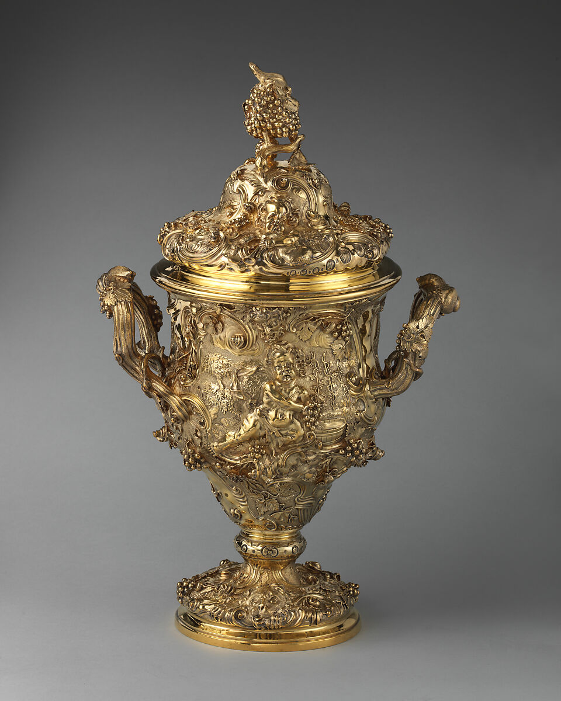

# Rococo — Reviewed Real-work References

> **Public distribution availability:** This is the conservative public edition: 9 bundled images, 34 withheld, with 28 of 36 directions lacking local visual comparators. Historical visual-review notes below describe earlier inspected source images, not a claim that withheld images are present or newly inspected. Check `availability` in catalog/records and the [publication policy](../publication-policy.json). Do not download missing files automatically or infer visual confirmation from text.

[Attribution criteria](../../references/03-western-classics/17-rococo.md) · [Material index](../README.md) · [Correspondence review](../correspondence-review.md)

**Read the role before using an image.** `style_reference` is a scoped example of a named branch, not a universal or exclusive positive label. `context_only` supplies historical/site/method background and must not be used alone to establish stylistic membership.

## Distinguishing the nearby explanations

- Shared appearances: Curved handles, gold and relief decoration overlap with Baroque and other decorative traditions.
- Inspectable distinction: Retain as British Rococo silverwork. This is useful counterevidence to an all-over-asymmetry rule. Distinguish curling, spreading relief organization from generic gold color, and do not turn every curved handle into a shell.
- Nearby explanations: 16-baroque, 18-neoclassical.

## Loving cup with cover, Met object 25.15.58a, b

- Asset ID: `17-rococo-01`.
- Reference role: **`style_reference`**.
- Claim scope: British Rococo silverwork; official catalogue explicitly calls it full-blown early-1740s Rococo; this exact view and branch only, not an exclusive or universal style label.
- Creator: Paul de Lamerie.
- Work/version date: 1742–1743.
- Image credit/date: unknown / not separately credited; unknown / not separately stated.
- Source: [provider page](https://www.metmuseum.org/art/collection/search/195267); [identity/context](https://www.metmuseum.org/art/collection/search/195267).
- Full local record: [17-rococo-01.json](../records/17-rococo-01.json).

### Visible relationships in this exact image

- Ribbed curved handles branch outward from a generally bilateral cup and reconnect with its ornamented body.
- Linked scrolls, leaf-like edges and irregular relief contours spread across the cover, cup and foot.
- A small figural relief is integrated with vine and fruit clusters rather than isolated in a plain geometric panel.
- A grape-cluster finial crowns the cover while local curling details vary around the vessel's central vertical organization.

### Documentary context and limit

British Rococo silverwork; official catalogue explicitly calls it full-blown early-1740s Rococo; this exact view and branch only, not an exclusive or universal style label.

A specific British silverwork branch is not a universal model for French Rococo rooms. The curator identifies Bacchic vine/fruit ornament; do not relabel every curved handle as a shell, or assume a generally bilateral vessel must have a fully asymmetric overall silhouette.

### Rights and attribution

Public Domain on object page; Met Open Access CC0

Paul de Lamerie, Loving cup with cover, 1742–43, The Met, Bequest of Alfred Duane Pell, 1924, 25.15.58a, b; CC0.

[Provider-stated license / rights basis](https://www.metmuseum.org/hubs/open-access)

## Apply this evidence

Compare the organizing relationships, not just the palette, materials, names or period. These directions can overlap or contain one another; the neighboring explanation is not automatically a mutually exclusive label. Source records establish facts about this named work and cannot authenticate a new object. Two views of one project are complementary views, not independent corroboration.

When only text is available, state that the image was not inspected. Do not promote a `context_only` image to a positive example merely because a source discusses the broader aesthetic.
