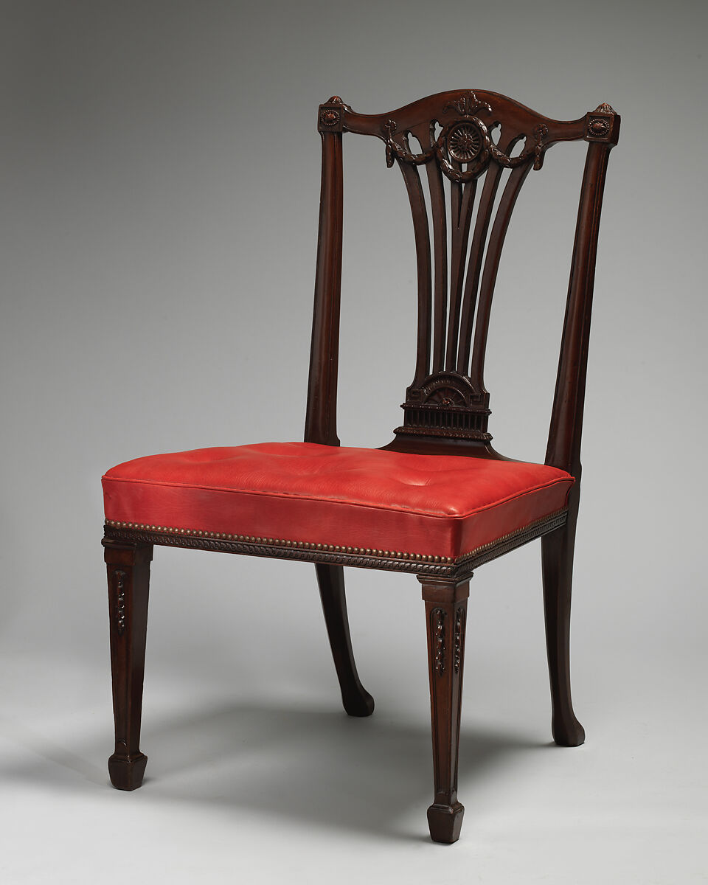

# Neoclassical — Reviewed Real-work References

> **Public distribution availability:** This is the conservative public edition: 9 bundled images, 34 withheld, with 28 of 36 directions lacking local visual comparators. Historical visual-review notes below describe earlier inspected source images, not a claim that withheld images are present or newly inspected. Check `availability` in catalog/records and the [publication policy](../publication-policy.json). Do not download missing files automatically or infer visual confirmation from text.

[Attribution criteria](../../references/03-western-classics/18-neoclassical.md) · [Material index](../README.md) · [Correspondence review](../correspondence-review.md)

**Read the role before using an image.** `style_reference` is a scoped example of a named branch, not a universal or exclusive positive label. `context_only` supplies historical/site/method background and must not be used alone to establish stylistic membership.

## Distinguishing the nearby explanations

- Shared appearances: Carving and classical motifs overlap with Rococo and earlier classical revivals.
- Inspectable distinction: Retain. Distinguish bounded classical motif/component relationships and recorded revival context from the presence/absence of carving. Red leather is a modern replacement, not original-period material evidence.
- Nearby explanations: 13-classical, 15-renaissance, 17-rococo.

## Side chair (one of a set of fourteen), Met object 1996.426.10

- Asset ID: `18-neoclassical-01`.
- Reference role: **`style_reference`**.
- Claim scope: British Neoclassical furniture made for Goldsborough Hall; the upholstery is modern replacement; this exact view and branch only, not an exclusive or universal style label.
- Creator: Designer Robert Adam; supplied by Thomas Chippendale, as credited in the current Met record.
- Work/version date: circa 1772.
- Image credit/date: unknown / not separately credited; unknown / not separately stated.
- Source: [provider page](https://www.metmuseum.org/art/collection/search/841568); [identity/context](https://www.metmuseum.org/art/collection/search/841568).
- Full local record: [18-neoclassical-01.json](../records/18-neoclassical-01.json).

### Visible relationships in this exact image

- A fan-shaped open back splat rises toward a central round rosette below a shallow arched crest.
- Paired hanging swags and small terminal motifs are organized around the back's center.
- Straight, square-section front legs taper downward and carry narrow vertical carved ornaments.
- A largely rectangular seat frame and repeated beaded or molded borders contain the decorative details within a clear structural outline.

### Documentary context and limit

British Neoclassical furniture made for Goldsborough Hall; the upholstery is modern replacement; this exact view and branch only, not an exclusive or universal style label.

Keep the exact object/image match: some sibling set records show a shared primary caption 1996.426.10 even when their catalogue object number differs. This selected record matches both. Do not use replacement upholstery as original material evidence or collapse all Neoclassical branches into this chair.

### Rights and attribution

Public Domain on object page; Met Open Access CC0

Robert Adam (designer), supplied by Thomas Chippendale, Side chair, ca. 1772, The Met, 1996.426.10; CC0. Credit Line: Purchase, Lila Acheson Wallace and The Annenberg Foundation Gifts, Gift of Irwin Untermyer and Fletcher Fund, by exchange, Bruce Dayton Gift, and funds from various donors, 1996.

[Provider-stated license / rights basis](https://www.metmuseum.org/hubs/open-access)

## Apply this evidence

Compare the organizing relationships, not just the palette, materials, names or period. These directions can overlap or contain one another; the neighboring explanation is not automatically a mutually exclusive label. Source records establish facts about this named work and cannot authenticate a new object. Two views of one project are complementary views, not independent corroboration.

When only text is available, state that the image was not inspected. Do not promote a `context_only` image to a positive example merely because a source discusses the broader aesthetic.
