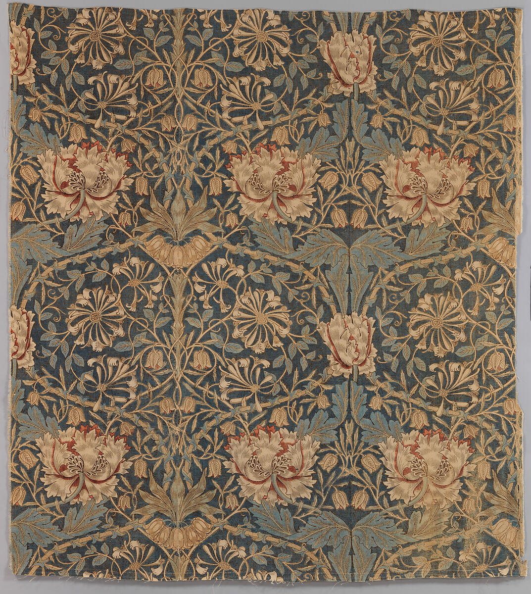

# Arts and Crafts — Reviewed Real-work References

> **Public distribution availability:** This is the conservative public edition: 9 bundled images, 34 withheld, with 28 of 36 directions lacking local visual comparators. Historical visual-review notes below describe earlier inspected source images, not a claim that withheld images are present or newly inspected. Check `availability` in catalog/records and the [publication policy](../publication-policy.json). Do not download missing files automatically or infer visual confirmation from text.

[Attribution criteria](../../references/04-materials-and-everyday-life/19-arts-and-crafts.md) · [Material index](../README.md) · [Correspondence review](../correspondence-review.md)

**Read the role before using an image.** `style_reference` is a scoped example of a named branch, not a universal or exclusive positive label. `context_only` supplies historical/site/method background and must not be used alone to establish stylistic membership.

## Distinguishing the nearby explanations

- Shared appearances: Botanical decoration also occurs in Art Nouveau and generic printed textiles.
- Inspectable distinction: Retain as Morris textile branch. Explain flat repeating units and ground relationships; the photo does not prove hand printing, labor conditions or the movement identity of a new object. Do not require foliage for every historical Arts and Crafts object.
- Nearby explanations: Art Nouveau, generic botanical pattern.

## Honeysuckle, Met accession 30.95.46a–f

- Asset ID: `19-arts-and-crafts-01`.
- Reference role: **`style_reference`**.
- Claim scope: Arts and Crafts printed textile; this exact view and branch only, not an exclusive or universal style label.
- Creator: William Morris.
- Work/version date: design registered 1876; printed 1876–77.
- Image credit/date: unknown; unknown.
- Source: [provider page](https://www.metmuseum.org/art/collection/search/222341); [identity/context](https://www.metmuseum.org/art/collection/search/222341).
- Full local record: [19-arts-and-crafts-01.json](../records/19-arts-and-crafts-01.json).

### Visible relationships in this exact image

- Repeated honeysuckle and foliage units
- Interconnected stems and alternating negative spaces
- Motif rhythm extending across a textile surface

### Documentary context and limit

Arts and Crafts printed textile; this exact view and branch only, not an exclusive or universal style label.

Only the displayed view is inspected; no claim about unseen parts, a newly supplied object's manufacture, or authenticity.

### Rights and attribution

Public Domain; The Met Open Access

William Morris, Honeysuckle, design registered 1876, printed 1876–77. Linen. The Metropolitan Museum of Art, 30.95.46a–f, Theodore M. Davis Collection, Bequest of Theodore M. Davis, 1915. Public Domain.

[Provider-stated license / rights basis](https://creativecommons.org/publicdomain/zero/1.0/)

## Apply this evidence

Compare the organizing relationships, not just the palette, materials, names or period. These directions can overlap or contain one another; the neighboring explanation is not automatically a mutually exclusive label. Source records establish facts about this named work and cannot authenticate a new object. Two views of one project are complementary views, not independent corroboration.

When only text is available, state that the image was not inspected. Do not promote a `context_only` image to a positive example merely because a source discusses the broader aesthetic.
